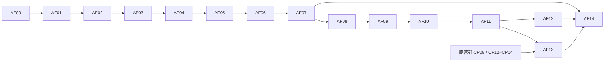

# MiniAdsWall 运营决策反馈链路 Coding Plan

- 日期：2026-10-11
- 对应：[SDD](agent-feedback-sdd.md)
- 状态：AF00–AF14 全部 pending；当前只完成设计文档，未运行业务验收。
- 执行方式：按依赖逐项实施；每项完成代码、必要检查与证据后更新状态，不一次性把整阶段勾完。

## 1. 阶段与依赖

| 阶段 | 任务 | 完成后能说什么 |
| --- | --- | --- |
| F1 基础反馈 | AF00–AF07 | 建议、运营决定和修改稿可持久化、可查、可恢复 |
| F2 案例复用与观察 | AF08–AF12 | 历史处理可检索复用，后续效果可按快照观察；质量收益单独判断 |
| F3 执行关联 | AF13 | 人工确认后业务操作与反馈、执行回执、效果记录连通 |
| 分阶段发布 | AF14 | 已通过的阶段具备发布、停用和兼容回滚记录 |



AF14按F1/F2/F3分别执行，不要求为交付F1先完成F3。AF08的索引协议在AF02冻结；AF09之前检索开关保持关闭。任何需要真实MySQL/模型/浏览器的步骤缺依赖时标pending或skipped，不能用mock替代其验收。

## 2. F1：建议、反馈和修改稿

### AF00：冻结基线与已有任务边界

- 状态：pending；依赖：无。
- 工作：记录当前分支、未提交修改、涉及文件哈希；核对营销010–013、运行时RAG证据检查、托管实际调用和配置；不恢复/覆盖其他任务文件。
- 工作：记录旧聊天、托管会话/SSE、报表查询、品牌权限、操作查单的现状；核实总计划014–017占号与018可用性。
- 产物：`docs/validation/agent-feedback/baseline.md`、机器可读baseline.json；声明当前数据库和模型是否可用，禁止输出凭据。
- 验收：有当前证据和明确失败基线；未知状态不填通过。

### AF01：冻结契约、状态与示例

- 状态：pending；依赖：AF00。
- 新增：`contracts/agent-feedback/v1/schema.json`、examples.json；`apps/mini-ad-wall/server/types/agent-feedback.ts`、服务端contract适配；`marketing/feedback/contracts.py`。
- 实现：generation、建议、三态反馈、visibility、retrieval、observation、receipt及错误schema；unknown字段拒绝、长度/字节/枚举限制；subject和delta等可信字段不进入浏览器写契约。
- 实现：反馈revision与幂等互不替代；定义字段缺失/null、行动目标、报告hash、规则hash、未执行/未发布状态；补Koa/Python同一fixture正反例。
- 产物：协议与SDD字段一致；契约测试包含错误scope、reason/final_text缺失、引用伪造、NaN/超长/未知字段。
- 验收：AC02/AC06的输入规则有可执行测试；本项不实现接口或声明闭环通过。

### AF02：增量表、迁移和兼容发布底座

- 状态：pending；依赖：AF01。
- 新增：`server/migrations/018_marketing_agent_feedback.sql`（编号AF00确认后冻结）。
- 修改：`services/marketing/migrations.ts`、迁移测试/运行说明；登记显式文件列表、目标版本与校验；新表符合现有结构验证器支持范围，不悄悄跳过FK/CHECK核验。
- 实现：SDD八张表、复合scope约束、唯一键和有界查询索引；无需已规划014–017才能运行F1/F2，未来升级路径单独测试。
- 实现：新功能关闭的兼容版本识别018；应用启动只检查、不自动DDL。测试新库、已有013库、重复迁移、中断/重试、旧表冲突与校验不符。
- 验收：AC01；真实MySQL结果保存`migration.md`与日志；回滚基准必须认识018。

### AF03：共用授权、反馈事务与历史查询

- 状态：pending；依赖：AF02。
- 修改：`services/marketing/resource.service.ts`、report.service.ts；抽出`authorization.ts`，保留原成员读/operator写行为。
- 新增：`services/agent-feedback/repository.ts`、decision.service.ts、`routes/agent-feedback.routes.ts`；注册路由及新开关。
- 实现：建议详情/分页、追加反馈、案例可见性；写入复用`mutate/currentAdsConnection/recordOperationChange`，不在service再开第二事务；decision/case/outbox与操作/审计同事务提交。
- 实现：稳定锁顺序、expected_revision、读写撤权检查、scope外键、撤回立即阻断；同键冲突与同revision并发冲突分别表达。
- 新增测试：`server/tests/agent-feedback.test.cjs`、helpers；使用真实隔离MySQL证明双进程竞争，不能只测同进程Promise。
- 验收：AC02/AC03；反馈接口不修改广告或素材；索引与receipt尚未启用。

### AF04：生成请求与托管桥接 Worker

- 状态：pending；依赖：AF03。
- 新增：generation.service.ts、hosted-client.ts、bridge.worker.ts、`server/scripts/agent-feedback-bridge.ts`；hosted-client抽取agent.routes已有登录能力并做兼容回归。
- 实现：报表hash/品牌/目标固定，202响应和submit_run outbox同事务；事务外校验已有session归属，未有会话时UI先创建并确认；固定run key与按key查run入口，不新增桥接自动建会话逻辑。
- 修改：`hosting/api.py`、repository.py；新增带owner授权的by-key查询；RunInput支持feedback_context/schema_version=1，保留旧请求；网关删除浏览器伪造feedback_context。
- 实现：桥接租约token、批量上限20、网络调用出事务、指数退避最多自动8次后需人工重试；未知提交优先查单，原键重发；collect_result任务唯一；取消关联run。
- 新增测试：`tests/test_hosting_feedback_input.py`、server bridge集成测试；服务不可用、响应丢失、提交后崩溃、错误会话与取消。
- 验收：AC02/AC04；一份generation最多一个run；新类型Worker能力检查/排空升级策略可验证。

### AF05：共享生成器、规则版本与完整产物

- 状态：pending；依赖：AF04。
- 新增：`marketing/feedback/generator.py`、rules.py、`mcp/feedback_tools.py`。
- 修改：`hosting/pipeline.py`、`api/main.py`及ChatRequest/编排Request适配；共用schema、当前报表证据和规则snapshot；同步入口仅接受受信Koa生成上下文，网关删除浏览器伪造字段；普通聊天不强制转新协议。
- 实现：≤3建议，事实/假设/缺失分开、引用集合校验、动作白名单、修改草稿；已有证据检查不能用历史案例补事实。本阶段无历史案例仍可运行。
- 实现：rules/Skill hash、model/prompt/schema_version与报告hash记录；规则不匹配明确失败；没有新增模型写工具或额外通用反思调用。
- 实现：`ctx.tool('feedback_result')`保存完整JSON output_ref；工具/最终run沿用fence、deadline、取消与对象失败语义。同步链路输出产物，但不能绕过Koa直接创建可采纳suggestion_id。
- 新增：`tests/test_feedback_generator.py`、test_feedback_pipeline.py；缺指标、假引用、假执行、模型格式错误、旧fence、缺对象、同步/托管契约一致性。
- 验收：AC04/AC06；mock证明控制规则，真实模型调用是否成功另记。

### AF06：终态产物落库与恢复

- 状态：pending；依赖：AF05。
- 修改：bridge.worker.ts、repository.ts；必要时新增托管产物读取适配，不扩大普通对象读取权限。
- 实现：从succeeded run的feedback_result完整对象读取；验证subject、session、generation/input/artifact hash；校验后短事务一次写suggestions和retrieval元数据，最后置ready。
- 实现：generation/item_no唯一与当前租约条件更新；恢复复用首次输入，格式错误不循环；撤权blocked；未完成run禁止反馈按钮；已有ready结果不能被取消任务覆盖。
- 故障注入：工具完成后run未终态、最终成功后响应丢失、收集前后崩溃、对象损坏、任务取消、旧lease回写。
- 验收：AC04；实际托管Worker+隔离MySQL跑通一例，产物与数据库可逐字段对账。

### AF07：建议卡、人工改稿和 F1 验收

- 状态：pending；依赖：AF06。
- 新增：`client/src/components/AgentFeedbackCard.tsx`、FeedbackDraftDiff.tsx与样式、`types/agent-feedback.ts`。
- 修改：MarketingDashboard.tsx、AIAssistantPanel.tsx、api.ts；从已查询report_id触发，托管任务状态与已落库建议状态分开；建议卡可刷新恢复。
- 实现：采纳/拒绝/修改保存、理由校验、原稿/最终稿差异、冲突人工合并、未保存草稿与身份切换清理；“已保存，未执行广告变更”明确展示。
- 实现：幂等写超时复用原key/参数，先查现有operations；查单不可用不重发；401重认证后继续查；保存key不保存token。
- 新增浏览器测试：生成→三态反馈→刷新→409→未知提交恢复；窄屏、键盘、读写权限、索引关闭；旧助手SSE/审批回归。
- 验收：AC01–AC04/AC07/AC11；`docs/validation/agent-feedback/F1.md`逐项列结果与截图。F1通过时只标AF00–AF07完成。

## 3. F2：案例复用、效果观察和质量验证

### AF08：案例索引、乱序保护与重建

- 状态：pending；依赖：AF07。
- 新增：`marketing/feedback/indexer.py`、index_repository.py、worker.py；必要内部SQL读取适配；独立collection配置及受限账号说明。
- 实现：处理index_case/delete_case outbox；每批20、租约token、幂等upsert(case_id:case_revision)、当前case_revision条件回写；decision_revision与可见性版本分开；case_key/query共用schema；不索引普通聊天/自评或被撤回案例。
- 实现：embedding版本固定；变更时重建新collection并核对；只写脱敏摘要，不复制全部业务快照；清理错误旧版本的SQL兜底。
- 新增：`scripts/rebuild_feedback_index.py`与case状态核对报告；断网、重复投递、旧upsert晚到、撤回/修订竞争、Worker崩溃/重建测试。
- 验收：AC05；实Chroma+MySQL验证，不以mock索引声称重建成功；索引不开启也不丢反馈。

### AF09：受限检索、时效排序与检索快照

- 状态：pending；依赖：AF08。
- 新增：retrieval.service.ts、内部cases/search路由；`marketing/feedback/retrieval.py`；内部token校验和身份映射。
- 实现：scope/目标/规则预过滤、20候选SQL复核、≤6上下文/24KiB、时间衰减/正反例选择、模式/截断/索引滞后；没有拒绝案例不伪造。
- 实现：索引2秒超时、最多200条结构桶SQL fallback；查询计划验证有索引；相似度归一化与embedding版本绑定，不假称降级等价。
- 实现：首次选择持久化retrieval snapshot；重试固定输入和案例revision/hash；撤权阻断；后续效果不进入历史问题当时的检索键。
- 验收：AC02/AC05/AC12；跨品牌/撤回/旧revision零泄漏；同快照重放可复现实际上下文。

### AF10：两条 Agent 链路接入案例与来源展示

- 状态：pending；依赖：AF09。
- 修改：feedback生成器、托管Pipeline、同步/chat、建议卡详情。
- 实现：current_business_evidence/current_rules/historical_cases分区；案例只影响处置建议；当前事实检查仍只看当前证据。展示引用案例的决定、理由、时间、修订及执行状态。
- 实现：检索关闭/故障时继续原报表+规则方式并明示未用案例；普通聊天无scope不查案例；禁止从用户文本夹带身份/规则/执行指令。
- 验收：AC06/AC07/AC11；固定案例“AI加价被运营拒绝，改标题”可在下一问题中被正确引用；当前缺曝光不能被历史案例洗成证据充分。

### AF11：同口径后续报表比较

- 状态：pending；依赖：AF10。
- 新增：observation.service.ts、`client/src/components/AgentFeedbackObservation.tsx`；decimal比较工具与共享fixtures。
- 实现：取现有不可变reports，复核scope/时区/归因/素材/窗口长度与重叠；服务端计算百分点/金额分/比值；零分母与缺失保留null；pending/provisional/stale分别表达。
- 实现：无receipt=unlinked_observation；不写“执行后收益”；修订、退款更正创建新观察，旧比较不变。用户选择after_report_id不等于有权伪造delta或有效标签。
- 新增测试：相同100曝光/10点击基线、等长后窗、CTR百分点与ROAS、缺费用、跨版本、跨品牌、退款、更正、重复比较与修订绑定。
- 验收：AC08；HTTP与浏览器读取同report/hash，原报告不变。

### AF12：冻结评测与 F2 验收

- 状态：pending；依赖：AF11。
- 新增：`evaluation/agent_feedback/`的开发集、冻结集、运行/匿名评分/分析脚本；不得覆盖历史RAG A/B数据及报告。
- 实现：≥20开发、≥40冻结测试问题；按活动/模板分组隔离，输入时间截断；索引样例不得含冻结问题答案或其未来处理结果。先固定规则/半衰期/选择版本。
- 比较：同报表、规则、模型的无案例/有案例两组；记录每次生成失败、引用、事实错误、人工一致性/可用性、修改量、Token/费用、p50/p95耗时。失败不算正确拒答。
- 人工：至少2人盲评并记录分歧；缺人工则质量验收pending，不能自动评分替代；不引用Uber成绩或凭采纳率宣称准确率。
- 性能：1万当前案例/10万修订，写20RPS与查5RPS各持续10分钟，报告p95/连接池/索引滞后和所有失败、降级；与普通报表/聊天隔离验证。
- 验收：AC05/AC06/AC08/AC10/AC12；证据保存`F2.md`、quality.json、performance.json与失败样本。达不到质量门槛则交付检索能力但保持默认关闭。

## 4. F3：关联真实执行

### AF13：业务回执与创意版本接入

- 状态：pending；依赖：AF11 + 原营销CP09、CP12–CP14对应能力验收完成。
- 原计划未完成时：本项保持pending，接口关闭，F1/F2仍可交付；不得临时加模型写工具或把generic approval当业务确认。
- 修改：原proposal/action/receipt outbox适配、`services/agent-feedback/receipt.service.ts`、托管业务回执入口与UI关联状态。
- 实现：查真实operation owner/key与目标/动作/版本/品牌/提交时间；唯一source/owner/key绑定一个suggestion revision；同提交的业务动作outbox消费后关联；跨服务调用出事务。
- 实现：最终人工稿生成新Creative版本，沿用审核/授权/发布流程，不原地改历史素材；反馈卡执行仅调用已验收Koa提案确认接口；保存决定和执行成功分开。
- 故障：已提交响应丢失、回执丢失、消费者崩溃、重复回执、跨品牌/伪造回执、另一运营先修改/撤权、发布审核失败、素材版本前后窗口映射。
- 验收：AC09；双Koa进程+真实MySQL+托管回执+浏览器端到端；`F3.md`缺一项就不能声明执行闭环完成。

## 5. 发布、交付与状态管理

### AF14：分阶段发布、回滚与文档

- 状态：pending；依赖：待发布阶段验收通过；F1=AF07，F2=AF12，F3=AF13。
- 配置：新增独立AGENT_FEEDBACK三开关及内部token/索引参数；Koa/Python语义一致，默认关闭，非法值与不存在前置能力启动拒绝。保留原marketingFlags的未实现保护。
- 发布：先部署认识018且功能关闭的兼容Koa；显式迁移；部署桥接/索引Worker和支持feedback_context的托管Worker；核对能力/版本后开F1，F2与F3各自验收后再开。
- 回滚：停新请求/领取，取消或排空新run，保留业务事实与幂等查单；关闭检索/回执；退回认识018的兼容版，禁止DROP或改checksum；验证旧013报表可查询。
- 更新：README、business-agent-boundary、marketing-api-contract、interview-demo以及新`docs/agent-feedback-implementation.md`；标清F1/F2/F3和synthetic/mock/实MySQL/真实模型/人工评测的不同证据。
- 验收：AC01/AC11与对应阶段AC；部署矩阵、功能停用和故障恢复操作可重复。

## 6. 每项记录模板

每完成一项，在本节追加记录并更新该任务状态；保留失败与重试证据，不用新报告覆盖原记录。

```text
任务：AFxx
状态：pending / in_progress / done / blocked
源码版本/工作区哈希：
涉及文件：
迁移/协议/规则/模型版本：
检查命令和结果：
证据路径：
mock / synthetic / 真实MySQL / 实Chroma / 真实模型 / 人工 / 浏览器：
失败、跳过、缺失前置：
对应AC及其状态：
可回滚版本和操作：
```

执行检查使用本项目可用的Node 22与`.venv`，先运行新变更对应的专项测试/构建；阶段结束运行已有广告、营销、托管与RAG回归。全量失败单独记录，不能因专项通过称全仓通过。凭据、会话token和原始个人信息不进入报告。

## 7. 最小演示验收脚本

1. 隔离synthetic品牌创建报告A，生成“建议加价”的结构化建议；页面显示证据和数据不足项。
2. 运营选择修改，理由“样本不足，先改标题”，保存最终稿；刷新仍可见，广告没有发生隐式变更。
3. 新问题生成时检索该案例，显示其反馈修订与理由；拒绝的加价建议不能被当成成功范例。
4. 同时提交两份同revision反馈，只接受一份；相同幂等键重放结果一致；索引乱序不能恢复旧版本。
5. 选择后续报告B，展示同口径差值；无执行回执明确显示“未关联执行，仅观察”。缺费用时ROAS保持null。
6. F3前置通过后再增加：人工确认Koa操作→丢失响应→原key查单→回执关联→新版本报表观察；业务版本只加一次。
7. 撤回案例/撤权/关闭新开关，下一次不再引用；旧报表与普通助手仍正常。把每一步结果与截图列入对应阶段报告。
