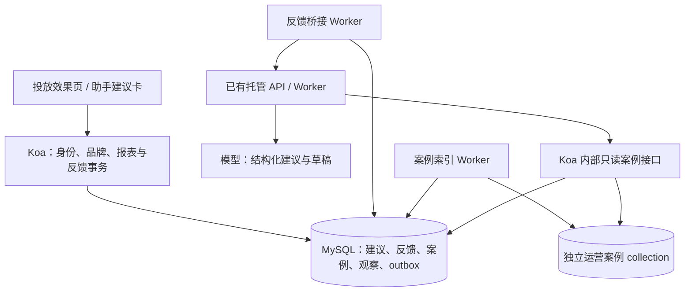

# MiniAdsWall 运营决策反馈链路 SDD

- 版本：0.1
- 日期：2026-10-11
- 状态：设计完成，业务代码尚未实施；所有容量、延迟和质量指标均为验收目标。
- 实施：[Coding Plan](agent-feedback-coding-plan.md)
- 范围：建议留档、运营反馈、历史案例检索、修改草稿、执行结果关联和效果观察。

## 1. 目标与交付边界

把一次运营处理保存为可追溯记录：

`可信报表 → AI 建议 → 运营采纳/拒绝/修改及理由 → 最终草稿 → 业务执行回执（如有）→ 后续效果快照 → 下次检索`

首版交付 F1、F2；F3 是必须单独验收的后续接入阶段：

| 阶段 | 可交付能力 | 前置条件 |
| --- | --- | --- |
| F1 | 从固定报表生成结构化建议，保存三态反馈和人工修改稿，页面恢复历史记录 | 营销 010–013 迁移与现有托管服务可用 |
| F2 | 检索经过运营确认的处理案例，显示来源；保存后续效果观察；冻结集对照评测 | F1；案例索引可用或明确降级 |
| F3 | 将反馈与已提交业务操作、创意新版本和托管回执连接，观察实际执行后的效果 | 原营销计划 CP09、CP12–CP14 对应能力通过验收；不能用通用工具审批代替 |

采纳不等于执行，改稿不等于发布，指标上涨不等于建议造成上涨。F1/F2 无真实操作回执时，只能称“建议反馈与案例复用完成”；F3 通过后才称“执行与效果关联完成”。

不新增模型直接调价、删除、预算扣费或批量写工具；不新增训练框架、不复制一套投放学习算法。新增草稿只保存最终文本，不修改已发布 Creative 或旧广告。

参考：[Uber 原文](https://www.uber.com/us/en/blog/building-ubers-redlining-agent/) 中的细粒度专家反馈、历史案例检索与规则分工。其 91% 准确率、20% 提效和 365 天半衰期均不是本项目成绩或必须照搬的参数。

## 2. 当前代码与需要补齐的地方

基线为 2026-10-11 的工作区源码，包含未提交变更；实施时重新核对，不覆盖其他任务修改。

| 当前落点 | 已有能力 | 本次新增 |
| --- | --- | --- |
| [report.service.ts](../apps/mini-ad-wall/server/services/marketing/report.service.ts) | 授权报表、不可变 report_id、内容哈希、费用覆盖与归因版本 | 建议固定引用这些快照，观察记录比较同口径快照 |
| [resource.service.ts](../apps/mini-ad-wall/server/services/marketing/resource.service.ts) | 品牌成员读权限、operator 写权限、活动/素材状态检查 | 抽出共用授权函数，反馈、案例、回执均重新授权 |
| [businessBoundary.ts](../apps/mini-ad-wall/server/middlewares/businessBoundary.ts)、[ads.model.ts](../apps/mini-ad-wall/server/models/ads.model.ts) | Koa 幂等事务、操作结果和审计 | 在同一连接内提交反馈、案例当前版本和索引 outbox |
| [AIAssistantPanel.tsx](../apps/mini-ad-wall/client/src/components/AIAssistantPanel.tsx) → [agent.routes.ts](../apps/mini-ad-wall/server/routes/agent.routes.ts) → [pipeline.py](../hosting/pipeline.py) | 页面实际使用托管 run、SSE、恢复与对象结果 | 新建议生成复用托管生命周期，终态产物入业务库后才开放反馈 |
| [api/main.py](../api/main.py)、[core/rag_evidence.py](../core/rag_evidence.py) | 同步分析；当前源码已有运行时证据检查 | 同步、托管共用案例与建议 schema，保留已有证据检查 |
| [运营 Skill](../skills/ads_optimization/SKILL.md)、[skill_loader.py](../core/skill_loader.py) | 可更新运营规范和输出格式 | 固定生成时规则摘要；将硬限制留在代码中 |
| [knowledge_base.py](../mcp/knowledge_base.py)、[conversation_memory.py](../memory/conversation_memory.py) | 文档检索、会话和画像 | 单独建运营案例索引；不把会话画像或普通聊天自动当专家决策 |

关系：本设计细化营销总计划 CP11 的报表诊断与 CP14 的建议界面，F3 接入既有 CP12/CP13；不替代 S2 的创意审核。原 CP19–CP21 的反馈是曝光/点击与 Bandit 学习；本设计反馈是人的处理决定，二者使用不同表、版本和验收口径。

## 3. 必须成立的约束

| 编号 | 约束 |
| --- | --- |
| INV01 | 身份来自 Koa 认证；品牌、环境、活动和素材归属由数据库验证，不能信浏览器 ads、user_id 或模型声明 |
| INV02 | 原建议、原报表、每次反馈修订和检索快照不可覆盖；修订追加新版本 |
| INV03 | 同一幂等键同请求重放；不同内容返回 409；同一建议同 expected_revision 并发最多一条新反馈 |
| INV04 | 建议、人的决定、草稿、执行结果和效果评价分别保存；不能共用一个 success 状态 |
| INV05 | 模型、Chroma、对象存储、托管 HTTP 调用均在业务事务外；事务仅处理已有产物与版本校验 |
| INV06 | MySQL 是反馈事实来源；索引只是可重建副本，旧反馈索引不得覆盖新修订或被撤回案例 |
| INV07 | 历史案例只能说明“以前如何处理”；不能替代当前指标、当前权限或现行规则 |
| INV08 | 所有用于生成的案例均经 SQL 复核授权、修订、规则版本和可见性；撤权后详情、反馈、导出和回执关联均拒绝 |
| INV09 | 未完成、失败、取消的 run 和流式片段不能成为可采纳建议；旧 Worker 结果沿用托管 fence_token 拒写 |
| INV10 | 缺费用、stale、窗口未结束、样本不足和索引降级均有结构化状态，不能补成零或编造收益 |

## 4. 架构与生成持久化



### 4.1 生成请求与托管 run

1. 页面提交 report_id、明确目标、问题类型、已有会话 ID 和可选素材版本，不提交指标或历史案例全文。没有会话时先使用现有会话接口创建、确认成功，再提交 generation。
2. Koa 读原快照并验哈希、授权和作用域；固定 report_id/hash、规则摘要及目标。用现有 `mutate` 提交 generation 与 `submit_run` outbox，同事务保存 202 操作结果与审计。
3. 桥接 Worker 事务领取 outbox 后立即释放连接；向托管服务提交 run，身份使用 generation.created_by 的已认证服务映射。run 幂等键固定为 `feedback-gen-{generation_id}`，重试不创建多个 run；请求输入固定，重试不重新生成报表。
4. 从 agent.routes 抽出可复用的托管客户端及登录缓存。session 必须属于同一 subject，并在创建 generation 前通过托管 API 校验；缺失或无法确认归属时拒绝创建，不由桥接 Worker 临时建会话。未知提交结果先用新增的“按幂等键查 run”接口确认，明确查不到才原键重发，查询不可用时保持未知状态。
5. RunInput 增加可选 `feedback_context`，独立 schema_version=1；旧输入仍可读。普通网关删除浏览器提交的 feedback_context；仅可信桥接器可以生成该字段。新 Worker 领取前校验能力；旧 Worker 不认识此类型不能领取，否则发布前必须排空并升级所有 Worker。
6. Pipeline 调用共享生成器；案例检索、现有证据检查、结构化建议生成分别留 trace。通过 `ctx.tool('feedback_result', ...)` 保存完整 JSON 到现有 output_ref，对象写入失败使 run 失败；不从 stdout_preview 或流式文本解析最终建议。
7. 桥接 Worker 读取终态 succeeded run 的工具列表和完整 output_ref，验证 subject、session、generation_id、input_hash、schema 与产物哈希；只接受最终成功执行中的 feedback_result。取消、失败、旧 fence 或对象缺失不入库。
8. 短事务锁 generation，复查品牌权限，插入最多 3 条建议、检索快照与完整生成元数据，再置 ready。同 generation/item_no 唯一；崩溃重放不重复建建议。撤权时置 blocked，不公开产物。

模型失败不产生假建议；UI 可以查看失败原因并创建新 generation。恢复仍用原输入；最多自动恢复 2 次，格式校验失败不无限重试。桥接故障不影响已保存反馈的查询。

generation 状态：`queued → submitted → ready | insufficient | failed | cancelled | blocked`。超时未知提交保持 queued/submitted，并标记 transport_unknown；不能提前称失败后再创建重复任务。取消需取消关联 run 并等待终态；取消前已经 ready 的建议保留。

### 4.2 两条分析链路

新增 `marketing/feedback/generator.py` 与 `mcp/feedback_tools.py`，统一案例选择、结构化产物及规则检查。托管 Pipeline 使用该生成器；同步 `/chat` 有 feedback_context 时调用同一实现，返回 suggestion payload，但只有经过 Koa 的 generation 持久化才发放 suggestion_id。

普通聊天保持兼容，无品牌/报表作用域时不检索运营案例、不产生可反馈卡。旧 `/chat` 不因为返回 decision=execute 获得业务写权限。已有 RAG 证据检查保留；不额外加一轮通用“自我反思”调用。

## 5. 数据模型与迁移

建议增量文件 `018_marketing_agent_feedback.sql`。当前落地营销迁移到 013，总计划已保留 014–017；实施 CP01 重新检查占号。只新建表，不改写历史快照或旧素材。

### 5.1 表定义要求

所有 ID 为服务端 UUID（VARCHAR(100)），时间 DATETIME(3) UTC；revision 使用正整数；hash 为 SHA-256 CHAR(64)。所有对象带 brand_id、environment；作用域外键优先使用复合键。字段列表为必须实现的逻辑字段，CP02 冻结实际 DDL 与 JSON schema。

| 表 | 必须字段及约束 |
| --- | --- |
| marketing_agent_generations | id、scope、campaign_id、report_id/hash、requested_by、session_id/run_id、goal、problem_code、input_json/hash、rules_version/hash、status、error_code、created_at；run_id 唯一；input_json ≤64 KiB；不能覆盖首次输入 |
| marketing_agent_suggestions | id、generation_id、item_no、ad_id/creative_id/version（可空）、action_type、observations、hypotheses、missing_data、proposed_text、reason、evidence_ids、model/prompt/schema_version、artifact_hash、created_at；UNIQUE(generation_id,item_no)；引用报告与检索快照；原内容不可修改 |
| marketing_agent_decisions | id、suggestion_id、revision、decision、reason、expected_action、final_text、actor、created_at；UNIQUE(suggestion_id,revision)；decision=accept/reject/modify；修改必须有 final_text；拒绝/修改必须有理由；反馈追加，不覆盖 |
| marketing_agent_cases | id、suggestion_id、case_revision、current_decision_revision、visibility、objective、problem_code、action_type、metric_basis_version、rules_version/hash、case_key、case_hash、index_state、updated_at；UNIQUE(suggestion_id)；反馈/可见性每次变更case_revision加1；状态 visible/withdrawn；case_key 不含用户隐私或模型虚构指标 |
| marketing_agent_retrievals | id、generation_id、mode、query_key、selected_refs、candidate_count、truncated、scores、sampling_version、embedding_version、index_lag、created_at；UNIQUE(generation_id)；保存 case_id/case_revision/decision_revision/hash 和实际用于生成的脱敏片段；≤24 KiB；生成后不改写 |
| marketing_agent_observations | id、suggestion_id、decision_revision、before_report_id/hash、after_report_id/hash、execution_receipt_id（可空）、comparison_status、execution_link_status、reason、metric_deltas、comparison_config/hash、observed_by、created_at；独立观察追加；UNIQUE(suggestion_id,comparison_hash)；comparison_hash必须包含decision_revision |
| marketing_agent_receipts | id、suggestion_id、decision_revision、source、operation_owner/key、action_type、target/version_before/version_after、committed_at、result_hash、verified_by；UNIQUE(source,operation_owner,key)；一张业务回执只能关联一个建议修订；F3 才写 |
| marketing_agent_outbox | id、scope、kind、aggregate_id、revision、dedupe_key、payload/hash、status、attempts、next_at、lease_until、lease_token、created_at；UNIQUE(dedupe_key)；kind=submit_run/collect_result/index_case/delete_case；每次领取增加 token，旧 token 拒绝完成/重试写入 |

最低索引：generations(scope,status,created_at,id)、decisions(suggestion_id,revision)、cases(scope,visibility,objective,problem_code,updated_at,id)、outbox(status,next_at,id)、observations(suggestion_id,created_at,id)。scope 表示 (brand_id,environment)。不靠 JSON 全表扫描检索。

### 5.2 反馈事务

在 `mutate → adsModel.executeOperation → currentAdsConnection` 中执行：

`授权 → 锁 suggestion → 检查 expected_revision → 插入 decision(revision+1) → 更新 case 当前决定并case_revision+1 → 写 index/delete outbox → recordOperationChange → 操作结果/审计提交`

统一锁顺序：品牌成员/作用域检查 → generation（若需要）→ suggestion → case → outbox。索引状态回写也先锁 case，再检查 revision；禁止跨服务长事务。单建议多操作者遵循版本冲突，首次 revision=0。

撤回案例不删除原反馈：检查 expected_case_revision，追加可见性变更审计、case_revision+1、置 withdrawn、写 delete outbox。撤回马上在 SQL 复核阻断，不能等索引删除完成才阻断。重新启用必须显式写权限与新案例修订；仍withdrawn时提交新反馈不自动重新收录。outbox revision与索引文档revision均指case_revision，decision_revision单独保存。

### 5.3 迁移兼容

现有 marketing 迁移器有显式 filenames、版本、校验和与 unknown_migration 检查；不能只放一份 SQL。新增 018 定义、结构验证与入口最低版本；沿用 SQL splitter，不手拆分号。

旧版本遇到未知 018 可能连旧营销入口也拒绝。先发布所有 Koa 副本都认识 018、但新功能关闭的兼容版本，再显式迁移，再升级 Worker/开启。回滚到该兼容版本，而不是直接回滚到完全不知道 018 的旧程序。回滚不开 DROP TABLE，不篡改迁移历史。若 014–017 后续落地，明确登记依赖与升级测试，不因版本数字跳跃自动认为它们已实施。

## 6. HTTP 契约

运营入口 `/api/marketing/agent-feedback`；内部入口另置 `/internal/agent-feedback`，不经过浏览器通用代理白名单。错误沿用 code/message/request_id。

| 方法与路径 | 输入/返回 | 授权与行为 |
| --- | --- | --- |
| POST /generations | report_id、goal、problem_code、session_id、可选 creative_id/version；202 返回 generation_id、status_url | operator；Idempotency-Key；事务外先确认会话归属；先持久化后调模型 |
| GET /generations/:id | 状态、建议 ID、失败/不足原因 | 品牌成员；逐次授权 |
| GET /suggestions | brand_id、campaign_id、cursor、limit | 同品牌分页，默认20/最大50；不返回其他品牌计数 |
| GET /suggestions/:id | 原建议、报告引用、反馈修订、案例来源、观察记录 | 读权限；引用对象另检查权限 |
| POST /suggestions/:id/decisions | expected_revision、decision、reason、expected_action、final_text | operator；Idempotency-Key；200 返回 revision、saved 状态；不执行广告变更 |
| POST /suggestions/:id/visibility | expected_case_revision、visible/withdrawn、reason | operator；幂等、案例修订冲突及审计 |
| POST /suggestions/:id/observations | decision_revision、after_report_id、可选 receipt_id | operator；服务端计算差值；幂等；不可由浏览器传 delta 或 success 标签 |
| POST /suggestions/:id/receipts | decision_revision、operation_key、source | F3；operator；服务端查实际操作、目标/动作/版本并核验；不能上传自报执行成功 |
| POST internal /cases/search | 服务映射的 subject、generation_id、固定查询键、limit | 专用内部凭据；重新授权；最多20候选/6入上下文 |
| GET hosting internal /feedback-runs/by-key/:key | 已知 owner 的固定幂等键对应 run | 既有服务认证与 X-Agent-Session；不可按客户端 subject 任意查他人 |

内部凭据新增 `AGENT_FEEDBACK_INTERNAL_TOKEN`，与运营、支付来源、通用 Agent 凭据分开；只绑定固定读接口和桥接操作。subject 只能由已验证 generation.created_by 或托管用户 auth_subject 解析，不能把用户消息里的 subject 当身份。索引 Worker 使用专用受限账号。

限制：reason 提供时1–2000字（accept可不提供，reject/modify/visibility必填）、final_text ≤8000字、goal ≤1000字；严格 schema，拒绝未知字段；整个写请求 ≤64 KiB；每 generation 最多3建议；未知 action_type 不可保存。建议动作首版为 observe/change_title/test_creative/review_bid，全部只形成建议，不暗含已执行。

反馈示例：

```json
{
  "expected_revision": 0,
  "decision": "modify",
  "reason": "曝光样本不足，先改标题，不加价",
  "expected_action": "change_title",
  "final_text": "通勤降噪耳机：先试听，再决定"
}
```

reason/final_text 仅代表运营决定或稿件内容；不得当商品事实验证、硬限制修改或工具执行授权。

## 7. 历史案例检索

### 7.1 记录与索引

只索引 operator 显式保存、当前 visible 的案例。普通对话、模型自评、未保存编辑、运行失败和未审核导入记录不自动收录。案例保留原建议与被纠正后的处理，reject 案例标明“原建议被拒绝”，不能当正面建议照抄。

查询和入库统一 case_key 结构：`objective + problem_code + action_type + 指标可用性/样本状态 + 运营问题摘要`。不直接拿整篇知识文档与一句问题做匹配，不使用后续结果生成当时的检索键，以免未来信息泄漏。

独立 collection 以 embedding_version 命名；ID=case_id:case_revision，metadata 至少含 brand_id/environment/objective/problem_code/rules_version/visibility/decision_revision。旧 revision 可删或保留为不可用历史；全量正文仅在 MySQL，索引写脱敏处理摘要。outbox at-least-once；写索引完成后用 case_revision+lease_token 条件回写。

撤回与修订 race：即使旧 upsert 在 delete 后到达，SQL hydration 必须拒绝旧 revision；不能认为删除 outbox 排序就足够。重建写新 collection，核对 SQL 当前版本后切换 alias/config；损坏索引可删除重建，反馈原表不能删。

### 7.2 检索与排序

1. 由可信报告确定 scope、goal、指标口径和当前规则；先过滤授权品牌/环境、目标和适用规则。
2. Chroma 取最多20候选，只返回 ID/revision/相似度；SQL 复核当前可见性、授权、目标、口径、规则和内容哈希。不按全库 Top-K 后才做品牌过滤。
3. 同 generation 首次检索保存完整 retrieval snapshot；模型重试使用原快照。若权限变化必须拒绝继续使用；规则变更需新建 generation，不暗中换规则。
4. 首版排序：`normalized_similarity × 2^(-age_days / half_life_days)`；不同 embedding 距离采用显式、版本化归一化，不混模型分数。半衰期默认90天、可配置；这是实验起点，冻结集评测前固定，不能宣称优于365天。
5. 最多6个例子，总计≤24 KiB；存在两类时尽量保留 accept/modify 和 reject，各最多3条；不造负样本，不以均衡名义牺牲作用域/口径一致性。排序版本、原分数和实际选中集合入库。
6. 无案例正常冷启动；索引超时2秒或不可用时用 SQL 的同 scope/目标/problem_code/规则桶读取最近最多200条，再做确定性词项匹配，选最多6条；mode=structured_fallback、truncated=true（如超过200）。不宣称回退等于向量召回。

F2 默认不增加 LLM 精筛调用；必要性由固定集证明后再单独实验。检索预算、命中率、拒绝旧案例比例与降级原因记录。索引故障允许继续基于当前报告和规则生成，但 UI 必须显示本轮未使用历史经验。

### 7.3 证据与规则

输入分开：current_business_evidence、current_rules、historical_cases。现有证据检查只能用前两者判断当前业务事实是否足够；历史案例绝不能让缺曝光/缺费用的问题变为“证据充分”。案例只辅助措辞与处置方案。

规则分工：

- 硬限制：授权、环境、版本、出价上限、无预算执行能力、费用覆盖与数据版本等，由代码检查；模型解释不能绕过。
- 软规则：发现/建议/验证指标、语气、标题风格与测试建议，由运营 Skill 维护。
- 建议带 rules_version、Skill 内容 hash、prompt/schema version；Worker 加载版本与固定输入不符时失败，不静默使用最新文件。
- 案例中的指令与旧规则当不可信文本；旧品牌规范不能覆盖当前规范。缺事实的改稿标 draft_needs_review，不进入发布路径。

生成后代码校验：引用 ID 来自输入集合、数值来自固定报表、动作在白名单、草稿长度符合限制、无“已经改价/保证收益”的执行声明。自然语言合规不能完全由关键词证明；保留已有证据检查与人工审核，并把其局限纳入评测。

## 8. 执行关联与效果观察

### 8.1 F1/F2 观察

后续报表必须同品牌、环境、活动、归因规则、时区和素材筛选范围；前后区间不重叠且长度一致，比较配置固定。版本切换前后的创意可通过 F3 回执映射；没有映射时不得自动把两个不同 creative_version 当同一对象比较。

每项按原指标 status/reasons 判断可比性：missing/stale/coverage不完整/零分母保持 null；provisional 保留 provisional。差值代码按十进制计算，CTR/CVR 输出百分点，金额输出分，ROAS 输出比值；相对变化在基线为0时 null。

比较状态 comparison_status=`pending / comparable / incomparable`，执行关联 execution_link_status=`unlinked_observation / verified_execution`，二者独立。无执行回执使用 unlinked_observation，即使两份报告可比也不能称“执行后收益”。accepted/rejected 不作为效果标签；没有执行的拒绝案例保留 null 执行结果。

观察追加，不改旧报告；退款、更正和新 coverage 生成新报告与新观察，旧比较保持原样。默认不按效果好坏筛掉反馈，以免只留下成功案例。

### 8.2 F3 回执

只接受 Koa 已提交操作/创意版本的可信回执；按原操作 owner/key 查结果，校验 action_type、目标、expected version、提交时间、品牌和当前权限。仅广告 CRUD 的旧操作不自动具备品牌关联，必须有营销归属与版本映射才能关联。

生成 draft 和运营修改稿原样保留；发布通过原 S2 审核与 S3 提案/确认接口。外部 HTTP 回执不能加入业务事务；原动作 outbox 与本设计关联消费者通过唯一 source/owner/key 幂等连接。F3 未实现时 receipts 入口返回 feature_disabled，UI 不出现执行按钮。

前后差值属于观察，不是因果。只有预先冻结分组、指标、样本规则和观察窗口的对照实验，才可单独讨论效果收益；本模块不凭两份报表声称“自动优化有效”。

## 9. 页面行为

- 在现有投放效果页已查询的报告旁增加“生成运营建议”，自动绑定 report_id；不让用户手抄指标。
- 建议卡显示发现、证据/缺失、建议、验证指标、草稿与历史案例来源；只显示已落库 ready 的建议。
- 采纳、拒绝、修改后保存分别操作；采纳可附理由，拒绝/修改必须填理由；保存反馈明确显示“已保存，未执行广告变更”。
- 修改文本展示原稿与最终稿差异，刷新从服务端恢复已保存内容。未保存修改留本地临时草稿，标未保存；不保存凭据，切身份/品牌清理临时草稿。
- 幂等操作超时沿用原键和请求摘要，先查 `/api/operations/:id`；查询不可用不重发，明确不存在才原键重发。409 显示最新修订与本地改稿供人工合并，不静默覆盖。
- 历史案例详情跳转前重新授权；显示反馈时间、决定、理由与是否有执行回执，隐去其他运营身份细节。
- 宽屏与移动端均可查看草稿、理由和证据；不靠颜色区分状态。
- F3 未通过时不显示执行、发布或“已提升效果”的控件；托管任务阶段文字只说明生成过程。

## 10. 开关、故障与发布

新增独立开关（默认 false）：`AGENT_FEEDBACK_ENABLED`、`AGENT_FEEDBACK_RETRIEVAL_ENABLED`、`AGENT_FEEDBACK_RECEIPTS_ENABLED`。依赖分别为 EVENTS；FEEDBACK；FEEDBACK + 已完成 S2/S3 能力。不要插入现有 marketingFlags 的线性依赖链，否则会被后续未实现开关阻塞。

Koa/Python 共用开关语义；配置值非法启动失败。依赖未实现时拒绝开启；需要018的新入口检查018，旧报表仍检查013。FEEDBACK 关闭不再创建/修改新记录，但已授权历史只读保留在兼容版本；检索关闭不影响反馈写入；索引 Worker 不把关闭当删除事实。

| 故障 | 必须行为 |
| --- | --- |
| 模型/托管服务不可用 | generation 保留；明确失败/未知提交；无假建议、无广告写入 |
| 桥接提交后崩溃或响应丢失 | 固定 run key 查询/重发；只建立一个 run，建议按 generation/item_no 去重 |
| 数据库提交反馈后响应丢失 | 原键查单；原反馈、审计和 outbox 同事务已提交 |
| Chroma 故障/索引滞后 | SQL 复核、明确降级或冷启动；反馈事实不丢失 |
| 撤权、案例撤回、规则更新 | 新生成重新授权；已固定旧任务阻断或要求新生成；不带旧权限继续 |
| Worker 租约失效 | 旧 token 不回写；最终产物只取托管 succeeded run |
| 错误发布 | 关闭写入/检索开关、停止对应任务领取；回滚到认识018的兼容应用，保留表和数据 |

## 11. 验收与评测

| 编号 | 通过条件 |
| --- | --- |
| AC01 | 新/旧库显式迁移、重复迁移、DDL中断、校验和/结构冲突、兼容版本回滚均有测试；旧报告仍可查询 |
| AC02 | 未认证、reader写入、跨品牌/环境/会话、伪造报表/subject/指标/引用 ID、撤权均拒绝，未产生非法写入 |
| AC03 | 双 Koa 进程竞争反馈：相同键重放一致；同 expected_revision 不同键最多一条新反馈；审计/outbox 不重复 |
| AC04 | 桥接提交/收集崩溃、对象缺失、取消、超时、旧 Worker、恢复：最多一个 run 与一份建议集合；不使用预览或流式片段入库 |
| AC05 | 反馈修订/撤回与索引乱序竞争仍不返回旧版本；索引重建恢复相同 SQL 可见案例集；模式/截断明确 |
| AC06 | 同步与托管使用同 schema、规则和案例选择；历史案例不能补齐当前缺失业务事实；假执行声明及假引用被阻止 |
| AC07 | 浏览器完成生成→采纳/拒绝/修改→保存→刷新→案例引用；冲突、本地草稿、未知提交、身份切换、移动端均验证 |
| AC08 | 差值单位、零分母、stale、缺费用、provisional、跨窗口/素材冲突、退款更正可重复验证；无回执不称执行效果 |
| AC09 | F3：已提交结果、重复/伪造/跨品牌回执、修改稿发布审核、响应丢失与回执延迟均经真实 MySQL/HTTP/浏览器验收 |
| AC10 | 固定集对照保存两组产物、引用、错误、延迟/费用、失败与人工判断；没有收益也如实报告 |
| AC11 | 关闭新功能后旧广告 CRUD、报表、普通聊天/托管审批与恢复仍工作；不改变现有模型并发门与权限 |
| AC12 | 有界性能与故障实验记录查询计划、索引延迟、连接预算、失败/降级比例，达到或未达到目标均明确 |

技术目标（需实测）：1万当前案例、10万历史修订；反馈写入20 RPS持续10分钟，排除模型调用的p95≤500ms；检索5 RPS持续10分钟，p95≤2秒；无故障索引滞后p95≤60秒。模型耗时单独报告，不计入反馈写接口；不得缩小数据集后宣称这些目标通过。

质量评测：先建≥20个开发案例；冻结≥40个独立测试问题，包含采纳/拒绝/修改、冷启动、过期规则、当前缺指标、跨品牌、提示词注入、错误案例。开发与冻结按来源活动/模板分组，避免近重复泄漏；索引案例时间必须早于测试问题。合成数据明确标 synthetic。

比较“当前报表+规则”与“同报表/模型/规则+历史案例”；先冻结半衰期、样本平衡和选择阈值。人工盲评核心建议是否符合参考决定、是否编造事实、引用是否正确、修改稿是否可用；记录误拒答、调用失败、p50/p95延迟、Token/实际成本。至少两名运营/评审独立判断并记录分歧；没有人工评审时质量验收 pending，自动评审只作辅助。

启用案例检索的最低门槛：AC02/AC05/AC06无越权或旧版本误用；冻结集无硬规则绕过；人工评审中支持度与可用性不劣于基线，额外p95耗时≤2秒。小样本与评审一致性不足不支持统计提升结论。真实提效必须另测完成一次处理的时间和修改量；采纳率不能替代正确率。

## 12. 交付与完成标准

交付 schema、增量迁移、Koa反馈服务、托管桥接/案例索引 Worker、共享Python生成器、建议卡、观察页面、可重复测试与 `docs/validation/agent-feedback/` 证据。

F1：AC01–AC04/AC07/AC11通过；F2：补齐AC05/AC06/AC08/AC10/AC12并决定检索是否可默认开启；F3：前置S2/S3及AC09通过。源码、模拟演示、真实MySQL验证、模型质量、真实运营收益分别报告；任何未完成阶段不写成“完整闭环已完成”。
