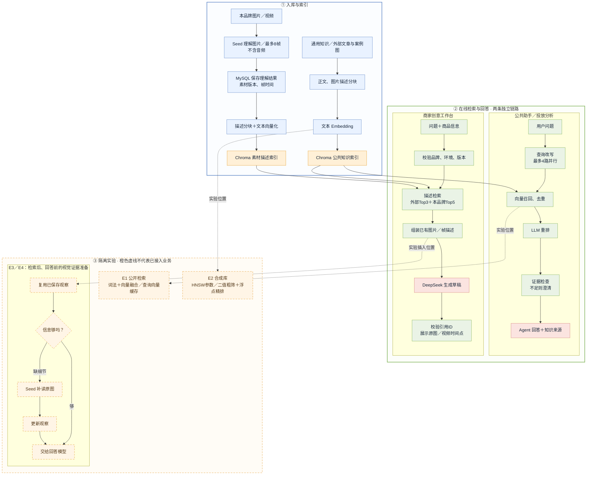
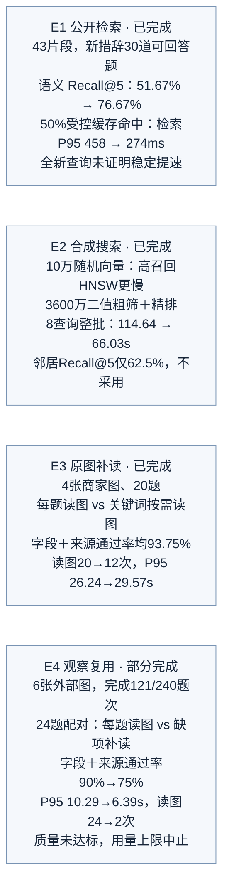

# MiniAdsWall：当前 RAG 全流程与实验位置

截至2026-10-15；实线为当前代码链路，橙色虚线为隔离实验。代码接入不等于生产验收。

## 实验结果

E1的混合检索与查询向量缓存未部署；业务原有查询改写已存在。早期改写小试的来源Recall@3为77.08%→72.92%，与E1正式语料口径不同。

E4四组主比较（自动字段＋必要来源诊断，未人工盲审）：

| 方案 | 通过率 | 回答P95 |
| --- | ---: | ---: |
| A 仅描述 | 40% | 1.90秒 |
| B 每题读图 | 90% | 10.29秒 |
| C0 仅复用观察 | 75% | 3.09秒 |
| C1 缺项才补读 | 75% | 6.39秒 |

E4固定正确参考图，不证明向量召回提高。各实验指标不同：语义召回、最近邻召回、回答字段通过率不可混用；批耗时不是单请求P95。初始理解成本在报告单列。

待执行：SQ8＋浮点精排只有方案；56张外部手串图已校验、暂定分组，尚未跑实验。

原图的位图编辑两次网络失败，未生成可交付的修改后PNG；此文件是按原图分区重新绘制的可编辑流程图。

[源码与实验依据](rag-full-flow-20261015.md)

