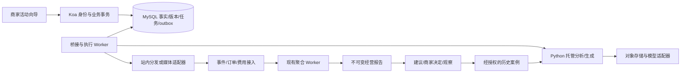

# 个人商家广告投放闭环 SDD

- 版本：1.1；日期：2026-10-13。
- 状态：设计完成，新增能力全部待开发、待验收；本次不实施业务代码。
- 定位：帮助没有运营团队的个人商家，用可控预算完成营销活动，并积累可复用的投放经验。
- 配套执行清单：[Coding Plan](merchant-growth-loop-coding-plan.md)。

## 1. 产品目标与范围

闭环：商品与需求 → 场景假设 → 素材理解/生成 → 小额试投 → 曝光/承接 → 经营账单 → 优化建议 → 商家确认 → 新一轮实验。

差异设计：个人商家低操作成本、有限预算验证、可解释结果、商家专属历史复用。不得宣传聚光或巨量没有类似功能；不得把模型评分当成商业效果。

首期面向单店、单商品、单币种 CNY 的预约服务或商品推广。每个活动最多 3 个场景，首轮仅 2 组实验。商家可以不使用 AI，手动填写事实、制作素材、运行同一流程。

### 1.1 分阶段交付

| 阶段 | 交付 | 可声明范围 |
|---|---|---|
| M1 | 商品档案、多模态素材体检、场景与素材草稿 | 素材辅助生产，不含自动投放 |
| M2 | 站内试投、承接、核销、冻结报告、建议与人工决定 | 站内可对账闭环；synthetic 数据显式标记 |
| M3 | 历史经验检索、下一轮复用、活动服务包计量 | 可复用的商家工作流；不承诺提升转化 |
| M4 | 单一真实广告渠道、商家身份体系、真实支付 | 完成对应渠道授权和真实验收后才称商业接入 |

M1–M3 不依赖真实媒体 API；M4 不能以手工导出或模拟回执替代。媒体实际预算硬上限必须由媒体能力保证；仅轮询花费不能承诺绝不超支。

### 1.2 用户界面

活动向导仅保留五步：商品资料 → 确认场景/素材 → 确认试投 → 查看经营账单 → 确认下一轮。

首页显示待确认商品事实、正在运行的活动、需处理的建议及历史活动。每步可保存恢复；失败项单独重试；不因关闭页面丢失已付费任务。所有页面明确展示环境、数据来源、执行状态。

粘性来自累积资料、偏好和历史决策，提供导出、删除/撤回入口；不通过限制数据迁出制造粘性。修改偏好必须商家确认，不把一次拒绝自动升级成永久规则。

## 2. 现有基线与设计衔接

2026-10-13 静态核对；未运行本次功能或数据库验收：

| 已见源码 | 现状/复用方式 |
|---|---|
| `server/routes/marketing.routes.ts` | 已有 serve、曝光、点击、转化、费用、报表、活动/素材接口 |
| `server/services/marketing/report.service.ts`、`013_marketing_reports.sql` | 已有报表与快照；新报告引用现有不可变快照 |
| `marketing/aggregation/`、010–012 迁移 | 已有归因、聚合及账本基础；复用口径，不另建一套订单事实 |
| `server/middlewares/businessBoundary.ts` | 已有运营凭据、mutate 幂等和 operations 查单；当前不是面向公众的账户系统 |
| `api/generation.py` | 已有创意/策略生成接口；不等于事实核验、审核和投放执行 |
| `api/video.py` | 已有 Seedance 文字/首帧图片生成视频；尚无本设计的持久化媒体任务和成本回执 |
| `hosting/` | 复用任务、对象产物、SSE、租约/fence；流式文本不能成为业务执行凭证 |
| `docs/agent-feedback-sdd.md` | AF00–AF14 为待实施设计，建议/决定/案例/观察模型优先复用 |

server/client 路径在本文分别指 `apps/mini-ad-wall/server` 和 `apps/mini-ad-wall/client`。

与旧计划的对应：M1 对应总计划 CP07–CP10；M2 依赖 CP05–CP06 验收、CP12–CP18 中实际使用能力及 AF 基础反馈；M3 对应 AF08–AF12。旧 SDD 中数据库权限、事件归因、金额、幂等、预算约束继续有效。本文件补充个人商家体验、实验对象和承接业务，不授权绕过旧验收门槛。

原 CP05/CP06 文档存在“已交付部分功能但仍未勾选整体验收”的情况，执行前按代码和证据复核，不能把它们整体视为已通过。

## 3. 必须成立的规则

1. Koa 是商家事实、审核、实验、预算、反馈和执行状态的权威写入方；Python 只提交候选产物。媒体适配器只执行已经持久化授权的任务。
2. 所有商家资源必须绑定 brand_id/environment；principal 来自认证，环境来自服务配置，客户端不能自行声明身份、订单来源或实际花费。
3. 图像观察、商家确认事实、营销假设分别存储。图片不能证明的防漏、功效、销量等不得自动成为商品事实。
4. 每条建议都绑定报告 hash、商品 revision、素材版本；旧提案在输入变更后不可执行。
5. 业务写使用 Idempotency-Key 和 expected_revision；同键异参 409、版本过期 409；网络超时先查单。
6. 模型/对象存储/媒体请求均在事务外；业务状态、审计及 outbox 同事务。异步完成回写检查当前租约和版本。
7. 报告缺数据为 null，零值表示确实测得零；人工采纳不等于执行成功，执行成功不等于商业改善。
8. 付费生成提交结果未知时不重新提交。供应商不能按键查单时转人工核查，不声称端到端 exactly-once。
9. 外部渠道聚合曝光不得伪造成站内 visitor 事件；不同来源、口径的指标不可盲目相加。

## 4. 模块与调用链



新模块建议落点：`server/services/merchant/`、`server/routes/merchant.routes.ts`、`marketing/merchant/`、`client/src/components/merchant/`、`contracts/merchant/v1/`。复用已有营销、反馈和托管模块，不复制它们的事务、授权或任务实现。

## 5. 商品档案与多模态素材体检

本阶段细化见[营销创意工作台 SDD](merchant-creative-studio-sdd.md)：允许仅文字、简陋主体照片或已有广告起步；当前固定DeepSeek处理理解/文本，用户明确请求视频才调用Seedance；图片请求因Seedance无图片输出能力阻断。首次投放建议可在M1生成，无当前报告时保留假设和缺据，不能强制先完成M2。

### 5.1 输入与证据

商品档案包括名称、价格、币种、营业/服务范围、库存或可预约情况、已确认卖点、禁用表述、品牌语气。价格不是成本；毛利估算需要商家另填单位变动成本与折扣，记录估算版本。

上传资产首期限制：图片 JPEG/PNG/WebP ≤10 MiB、≤2000 万像素；视频 MP4 ≤100 MiB、≤60 秒；每任务最多 5 张图片或 1 段视频。校验文件真实格式/时长/解码上限，资源属于当前品牌。只接受登记的 asset_id；不允许浏览器给任意网络 URL 让 Worker 抓取。供应商读取使用短期签名地址，不公开原始存储路径。

视频转码/抽帧在受资源限额的独立进程中执行：均匀取样加场景切换，总计最多 24 帧，保存时间点；ASR 提取口播，OCR 提取画面文字。无声视频 ASR 为 not_applicable；模块失败记录 partial，不能宣称完整理解视频。

证据格式：`{evidence_id, asset_id, asset_hash, kind, text, bbox?, start_ms?, end_ms?, extractor_version}`。bbox 使用 0–1 坐标；时间范围不得超过原视频；候选事实引用有效 evidence_id，并标 observed/merchant_confirmed/hypothesis。

分析产物：观察事实、候选场景、信息缺口、互相矛盾项、修改建议。每项有来源和限制；模型 confidence 不视为正确概率。商品事实确认需要 expected_revision；旧素材分析仍可查，但不能覆盖新事实。

### 5.2 生成与审核

每场景结构固定为 audience_description、occasion、problem、supported_benefit、evidence_ids、status。场景初始为 hypothesis，商家确认为 approved_for_test，不自动称 validated。

生成输入冻结 product_revision、场景 revision、品牌偏好 revision、证据列表、模型/prompt/schema 版本。输出文案、脚本、素材资产和 claim_evidence 映射；无法支持的声明必须删除或阻断审核。用户输入、OCR/ASR 内容按不可信数据处理，不能覆盖工具权限或系统规则。

素材状态：draft → pending_review → approved/rejected；approved 版本不可原地编辑，修改产生新版本并重新审核。品牌经营者可兼任审核者，但必须显式确认且留 actor/time/hash。事实撤回或资产权限到期使关联素材失效，停止新分发。

任务状态：queued → running → succeeded/partial/failed/cancelled；provider 提交结果未知为 submission_unknown，只有查单或人工核对可推进。超时不直接退费又继续产出；收费任务先核对供应商终态再结算。

## 6. 试投实验与预算

实验冻结字段：campaign_id、product_revision、两组 creative_id/version、scenario_id/revision、allocation、assignment_version、primary_metric、窗口、最低样本规则、预算、停止条件、归因规则、timezone、channel、environment。

首期按既有 visitor_session_id + experiment_id 稳定哈希 50/50 分组；campaign 同时只允许一个运行实验。对比“场景”的实验允许整组内容不同，结论仅称场景素材组合差异；测试标题时其余素材、优惠、目标与分发保持一致。

状态：draft → ready → running → paused/completed/stopped；ready 必须两组素材审核通过、落地页可用、预算有效、采集健康。进入 running 后配置不可改；改动必须停止并新建实验。原实验保留。

站内使用既有 CPC 模拟预算协议：总/日/组预算按固定锁顺序检查，在唯一有效点击收费事务中同时扣减并记账；同 impression 最多一笔；所有余额不为负。实验组上限之和≤活动总上限。预算单位整数分；不接受浮点金额。耗尽后禁止新分发；已签凭证的点击仍须经过剩余额度检查，不能透支。模拟预算永远标注“模拟”，不进入真实服务收入。

首版统计规则：仅固定结束时间评估，不做按显著性随时停试；安全停止（预算、错误、资产撤回）仍立即生效。默认观察 7 天、每组至少 100 个独立分组会话，作为最低报告门槛而非充分统计功效。预注册主指标默认为会话核销转化率，点击率仅辅助指标。数据完整且观察成熟后输出差值及 95% 区间；区间包含 0 标 inconclusive，安全停试或污染标 stopped/contaminated。计算采用会话单位二项指标的固定版本区间方法（Wilson/Newcombe），不得把重复曝光当独立样本。首期两组一个主指标，禁止多组多指标挑赢家。

转化成熟期沿用既有归因窗口；后到退款创建新报告版本。样本功效、渠道随机化不可验证时只报告描述性差异。历史前后比较不宣称因果提升。

## 7. 曝光承接、预约与核销

落地页绑定活动、素材/实验版本；点击关联通过已有签名凭证和服务端会话传递，不信任用户拼接的 click_id。页面只展示商家已确认商品资料，可提交预约或领取一次性券码。

预约状态：submitted → confirmed → fulfilled/cancelled；无效线索通过追加反馈标记 duplicate/spam/unreachable/not_interested，保留原记录，不能随意删除低质量数据美化转化率。线索不自动成为订单。

券码高熵随机、数据库保存 hash，绑定品牌/活动/有效期；商家核销使用授权接口、幂等和锁，唯一核销记录阻断多终端重复操作。核销成功不自动生成支付收入：有支付凭据才由受信来源写 conversions；线下人工登记单独标 source=merchant_manual，不冒充渠道订单。没有可靠身份只能保证券码/事件级去重，不宣称跨设备去重。

公开预约入口加会话限流、请求去重和滥用监控；联系人加密存储，模型及案例索引不接收电话号码。默认预约联系方式在完成/取消后 90 天清理，保留脱敏聚合及必要账务引用；商家删除请求生成可追踪任务。

## 8. 经营账单与优化闭环

账单展示媒体花费、平台服务费、有效咨询、预约、核销、支付、退款、数据截止时间、费用完整性、归因规则。服务费与媒体费分别列，不混入旧媒体 ROAS 分母。

估算贡献 = 净收入 − 对应售出商品变动成本 − 媒体费 − 平台服务费；缺成本返回 null，称“估算贡献”而非净利润。获客成本分母必须明确是有效线索、核销还是新客户；无法识别新客户时不得称新客 CAC。

复用 AF 模型：generation → suggestion → decision(accept/reject/modify) → proposal → execution receipt → observation。建议≤3条，必须列 observations/hypotheses/missing_data，并引用 report_id/hash 和证据。

M2 允许建议创建下一轮草稿、暂停站内实验；“应用”先生成可审阅差异，商家确认后 Koa 复核权限、资源、版本和预算。旧 S3 set_bid 白名单不被本文件隐式扩权；暂停/启动/新建实验各自有独立执行器和验收。

提案默认 30 分钟过期，指向固定版本/参数/hash。确认后保存 execution intent；Worker 外部调用事务外进行；回执先 recorded 再 confirmed/failed/unknown，unknown 不显示成功。不自动提升预算、不自动创建付费素材任务。

观察绑定 before/after 报告、执行回执和完整性。商家选择“采纳”仅是偏好反馈；未执行观察标 unlinked。条件不一致或报告过期时阻止收益结论。建议流程失效不影响原报表可读。

## 9. 商家经验库与活动服务包

经验沿用 AF case/decision/observation，不另建第二套案例事实表。增加商品/场景/素材版本关联，保存成功、拒绝、失败、不确定案例。只检索当前品牌/环境且仍有权限的案例；SQL 复核版本/可见性，索引可重建。当前事实与历史经验分别传给模型，历史案例不能填补当前缺失指标。

优先结构化检索：同商品 → 同场景 → 同目标；最多 6 条，附时间、数据量、执行状态。180 天之前默认不选，商家可显式扩大时间；商品事实变更使冲突案例退出推荐，但保留历史。

首期活动包仅实现报价与用量台账，不收真钱。包内容由版本化 offer 定义：交付项、次数/有效期、单价、修改次数、失败退还规则。服务收费与第三方模型成本分别记录。

额度操作 reserve → consume/release，同 job_id/charge_type 唯一；取消前已明确成功的交付按报价结算，未交付释放，结果未知保留待核查。退款追加负向服务流水，不能改媒体账本。M4 支付需订单、签名回调、回调去重、查单与退款对账；浏览器返回“支付成功”不授予额度。

粘性评价：首轮活动完成率、7/30天再次创建活动率、历史资料复用率、建议采纳/实际执行率、每活动人工编辑时间。指标按环境分开，排除种子/测试账户；先采集基线，不预写提升比例。

## 10. 数据模型与迁移归属

公共字段：UUID id、brand_id/environment、revision、created_by、UTC DATETIME(3)、hash；scope 复合外键；金额 CNY 整数分且 ≤ JS 安全整数，累计/比值服务端 Decimal；JSON 大小≤64 KiB，长产物存对象引用。

| 新增/扩展逻辑对象 | 关键字段、约束、索引 |
|---|---|
| product_revisions | product_id/revision 唯一，facts_json、confirmed_claims、preferences_ref、hash；旧版本不可变 |
| media_assets / analyses | asset_hash/storage_ref/mime/size/owner；analysis job_id、input_hash、status、output_ref；scope+created_at+id 分页 |
| evidence_items | analysis_id/item_no 唯一，asset_ref、bbox/time、kind、text/hash；引用必须同 scope |
| scenario_revisions | product_id/revision、audience/occasion/problem/benefit、evidence_refs、approval；(scenario_id,revision) 唯一 |
| creative_provenance | 现有 creative_id/version 唯一，scenario_revision、product_revision、job_id、claims、approval_hash；不另建素材主表 |
| experiments / arms | frozen_config/hash、status/revision、primary_metric、window、budget_ref；arm 素材固定；campaign 运行槽唯一 |
| experiment_assignments | experiment_id/session_id 唯一，arm_id、assignment_version；serving decision 关联 assignment |
| landing_versions / leads / redemptions | 页面版本、归因凭证引用、状态、联系方式密文；(scope,code_hash) 唯一；预约与核销历史追加 |
| proposal/receipt/experience links | 复用旧 S3/AF 主表，仅增加实验、场景和事实版本关联，不重复执行回执 |
| offers / service_orders / usage_entries | offer_version、status、currency、quoted_amount；job_id/type 唯一；退款引用原收费 |

019 `merchant_foundation`：档案、资产、证据、场景、素材来源；020 `merchant_experiments`：实验/分组、承接、业务关联；021 `merchant_service_usage`：报价/额度/服务账。以上为候选编号，014–017 已由旧总计划保留、018 由 AF 预留；实施前统一迁移登记，不把尚未实施的旧文件视为存在。

若 CP07–CP10/CP17 已新增同义表，扩展原表，禁止并建；MF01 冻结字段映射、DDL、约束、索引及版本依赖清单。迁移管理器当前显式检查版本，必须增加 capability manifest，不能简单判断 max(version)>=21 就认为缺失的014–018能力可用。

DDL 采用增量迁移，不修改已应用010–013；失败可续跑、校验摘要冲突拒绝；应用启动只检查不自动DDL。回滚关闭功能并切到认识新增 schema 的兼容版本，不删除业务历史。

## 11. API 合约

新增 API 前缀 `/api/merchant/v1`，营销事件/报表继续用现有 `/api/marketing`。JSON Schema、示例、TS/Python 适配统一存 `contracts/merchant/v1/`。拒绝未知字段；列表 cursor 分页，默认20/max100。

| 方法与路径 | 核心请求 | 返回/权限 |
|---|---|---|
| POST /products/:id/revisions | expected_revision、facts、preferences | 201 revision/hash；品牌 operator |
| POST /assets | 上传登记/校验结果 | 201 asset_id；品牌成员写权限 |
| POST /analyses | asset_ids、product_revision、purpose | 202 job_id；品牌 operator |
| GET /jobs/:id | 无 | 状态/完整产物引用，授权下载 |
| POST /scenarios | product_revision、候选场景或 generation_ref | 201 draft；需服务端核对证据 |
| POST /scenarios/:id/approve | expected_revision | 200 approved_for_test |
| POST /creative-jobs | scenario_revision、product_revision、kind、offer_ref? | 202 job_id；冻结输入/用量预留 |
| POST /experiments | campaign_id、两组版本、冻结配置 | 201 draft；不立即投放 |
| POST /experiments/:id/transition | expected_revision、action=ready/start/pause/stop | 200/202 状态或执行 intent |
| GET /experiments/:id/report | 无 | 200 report_id/hash、完整性、比较结论 |
| POST /landing-pages | approved_product_revision、campaign_id | 201 draft_version；发布单独确认 |
| POST /public/landing/:token/leads | visitor关联、联系方式、请求去重键 | 201 不可枚举 receipt；公开限流 |
| POST /leads/:id/transition | expected_revision、action、reason? | 200；品牌 operator |
| POST /redemptions | code、expected_revision | 201 核销回执；不隐式记支付 |
| POST /experiments/:id/recommendations | report_id、goal | 202 AF generation_id |
| GET /experiences | product_id、cursor | 200 当前授权案例与效果限制 |
| POST /service-orders | offer_version、campaign_id | 201 演示订单/报价；M4 才连接支付 |

所有受保护写接口使用既有 mutate；公开预约使用独立 scope 限定去重事务，不能伪造 operator。建议决定/提案执行复用 AF/S3 路由，不重复发明 API。

通用错误 `{error:{code,message,request_id,retryable}, operation_id?}`：401/403、409 revision_conflict/idempotency_conflict、422 unsupported_claim/invalid_experiment、413 asset_limit、429 quota_exceeded、503 dependency_unavailable、202 submission_unknown。unknown 为任务状态，不把提交成功假装成最终成功。

示例冻结配置（其余字段由 Schema 详细约束）：

```json
{"campaign_id":"campaign_1","expected_revision":1,"channel":"onsite","arms":[{"creative_id":"c1","version":1,"scenario_id":"s1","scenario_revision":1},{"creative_id":"c2","version":1,"scenario_id":"s2","scenario_revision":1}],"allocation":[50,50],"primary_metric":"session_redemption_rate","duration_days":7,"min_sessions_per_arm":100,"total_budget_minor":20000,"currency":"CNY"}
```

## 12. 真实渠道与公众账户发布门槛

M1–M3 使用现有受控运营凭据与品牌成员关系，不把全站 operator token 发给多个不相关商家。公开注册上线前接入独立 subject、服务端会话、品牌创建/加入/撤权、角色管理与恢复流程；跨租户测试必须覆盖旧 /api/ads、上传、助手、对象下载、SSE 和查单，而不仅是新 API。

ChannelAdapter 能力接口：capabilities、validate、submit、lookup、pause、fetchStats、fetchSpend。每个渠道声明 supports_idempotency/lookup/hard_budget/experiment_assignment/refund。只有 API 授权、测试账号和契约通过后启用；不假设聚光/巨量向当前项目开放接口。

外部提交 key 由 intent_id 派生；timeout 转 unknown，lookup 后再决定是否原键补交；不支持幂等/查单则人工核对。渠道回执记录 provider_account/campaign/creative IDs、状态、时间和原响应 hash。授权撤销立即阻断新任务，已接受回执继续受控核对。

外部统计保存 source-native 维度及数据水位；通过显式适配生成报表，保留渠道归因窗口/延迟和平台口径。真实发布前必须完成一次有限预算的商家确认投放、暂停、数据回收和费用对账。

## 13. 可观测性、故障与开关

关联 request_id → job/run_id → product/scenario/creative revision → experiment_id/arm → serving decision → report/hash → suggestion/decision → intent/receipt → observation。日志屏蔽凭据与预约联系方式。

开关：MERCHANT_WORKSPACE_ENABLED、MERCHANT_MULTIMODAL_ENABLED、MERCHANT_EXPERIMENTS_ENABLED、MERCHANT_LANDING_ENABLED、MERCHANT_EXPERIENCE_ENABLED、MERCHANT_USAGE_ENABLED、MERCHANT_EXTERNAL_CHANNEL_ENABLED，默认 false；依赖不满足启动拒绝对应能力。关闭入口后继续查单、已接受事件、核销查询、任务核对与台账处理。

任务每品牌最多 2 个活跃媒体任务、待处理上限20；预处理120秒、模型调用90秒、整体任务15分钟为初始配置。付费提交不自动重试；只读查单指数退避最多8次后人工处理。收集/索引租约60秒，每批≤20，回写检查租约代次。队列满429；数据库不可用503且不确认写入。

模型故障保留手动流程；索引故障退回同品牌有界SQL（≤200候选）或不使用经验；聚合不新鲜显示延迟并禁用自动结论；渠道 unknown 阻止重复操作。容量和时间阈值需实测，本文不是性能成绩。

## 14. 验收与证据

| ID | 必须通过的用例 |
|---|---|
| AC01 | 跨品牌读写/对象下载/查单/SSE拒绝；撤权立即生效；环境隔离 |
| AC02 | 大图、伪格式、长视频、解码失败有界拒绝；原始商品文件不变；图片/OCR/ASR证据定位可复核 |
| AC03 | 图片无法证明的性能声明不自动确认；伪造引用拒绝；商品改版使旧提案过期 |
| AC04 | 付费提交响应丢失只查单；Worker崩溃/旧租约/重复产物不重复结算或发布 |
| AC05 | 同会话稳定分组；重复曝光/点击不重复计数；两个独立进程并发扣费不突破总/日/组预算 |
| AC06 | 预约/核销重复提交、跨店券码、过期券码均正确处理；核销不伪造支付；退款重算可对账 |
| AC07 | 无成本/费用不完整/未成熟/样本不足/停止污染保留对应状态；冻结报告不被迟到数据覆盖 |
| AC08 | 采纳/拒绝/修改保存后刷新可恢复；旧revision执行被拒；unknown不显示成功 |
| AC09 | 历史案例撤回和权限复核有效；当前缺数据不能由案例填补；无历史仍可工作 |
| AC10 | 用量预留/消耗/释放与退款重放结果一致；服务费与媒体费分账 |
| AC11 | 手机320px与桌面完整走通五步；刷新、断网、键盘、过期身份恢复；旧助手与广告页回归 |
| AC12 | M4真实渠道有授权、提交/暂停回执、花费对账和独立用户隔离；未通过不开放公众商业入口 |

M1 模型评测：冻结至少30个素材案例（图片/有声视频/无声视频/信息缺失/矛盾各有覆盖），人工标注可见事实与时间位置；报告事实错误、无依据声明、定位准确率、失败率、耗时和单次成本。事实支持率阈值在开发集定好再冻结测试集；安全用例要求零自动通过的无依据强声明，不能用平均分掩盖失败。

M2 固定数据端到端：两组各100会话，独立核销10/20，含重复、取消、迟到退款、缺费用；HTTP→DB→Worker→报告→UI逐项对账。不得仅用同名纯函数测试替代真实MySQL。

M3 对照评测固定商品、报告、模型与问题，仅切换历史案例输入，评估建议依据正确性、偏好遵守、事实污染、人工修改量、成本/耗时。商家留存和转化提升需要后续真实数据，不能由离线评测推定。

证据目录 `docs/validation/merchant-growth-loop/`：baseline、contracts、migration、M1、M2、M3、M4；每项记录commit/文件hash、环境、数据来源、执行命令、通过/失败/跳过、日志与截图。未执行一律 pending。

## 15. 设计来源

- 用户确认的个人商家定位、五环节闭环、低预算试投与商家经验复用需求。
- [笔记：2000字！看完巨量引擎消费品AI大会](https://www.xiaohongshu.com/explore/6aad3c7b0000000026015382?xsec_token=CB7HhhbtKHyJeiJorvRLu03Svu_niZcF7siHbtWyqdYB4=&xsec_source=app_share)：本会话已读取正文及封面/正文1–6页；场景理解、内容信息完整性和验证思路为启发，不是渠道能力或效果保证。
- [整体营销 SDD](整体业务向优化SDD.md)、[整体 Coding Plan](整体业务向优化coding%20plan.md)、[反馈 SDD](agent-feedback-sdd.md)、[反馈 Coding Plan](agent-feedback-coding-plan.md)。
