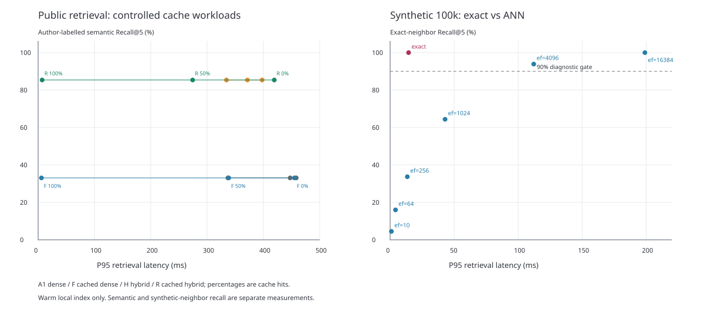

# 通用知识、外部案例与合成库：实测报告

日期：2026-10-14。未读取商家私有 SQL、素材或私有索引，没有新增付费模型请求。业务 RAG 代码没有部署这些实验优化。

## 结论

公开文字/图片描述语料上，新增措辞的 30 道可回答题 Recall@5 从 51.67% 到 76.67%，提高 25.00 个百分点。查询向量缓存能加速重复查询，但对全新查询没有同等收益。随机高维合成库中，快速 ANN/二进制粗筛损失邻居召回；高召回 ANN 又比精确扫描慢。不能据此宣布整个多模态 RAG 质量和速度都已改善。

## 语料、问题与固定项

- 43 个片段：30 个内置通用/业务公开参考片段，13 个外部文章和图片描述片段。每条 ID、正文与来源经过允许目录校验，只复制公开快照到隔离 Chroma。没有读取整个当前私有知识集合。
- 原 99 题：27 开发，72 测试（65 可回答、7 无 gold）；开发权重 0.75 从前一次开发集选择冻结，没有按新测试结果调整。原题已经使用过，不是独立盲测。
- 另提前冻结 38 道新措辞题（30 可回答、8 缺事实题）。仍共享来源、单人标注，不能称为独立来源测试集。
- 固定原始片段、384D 向量、查询、Top5、RRF k=60；文字检索使用标题加权中文二元词/英文词与向量排名融合。这是标题/正文混合检索，不是训练 STAIR，不是视觉编码器。
- A1=纯向量无缓存；F=缓存纯向量；H=混合无缓存；R=缓存混合。与工作台原方案四组含义不同；不测原图重读、补查、SQL 授权或答案生成。

## 公开检索质量

| 数据集 | 可回答题 | 基线 Recall@5 | 混合 Recall@5 | 基线完整证据 | 混合完整证据 |
|---|---:|---:|---:|---:|---:|
| 既有通用测试/all | 65 | 33.08% | 85.38% | 30.77% | 84.62% |
| 既有通用测试/general | 51 | 21.57% | 82.35% | 19.61% | 82.35% |
| 既有通用测试/external | 14 | 75.00% | 96.43% | 71.43% | 92.86% |
| 新增措辞/all | 30 | 51.67% | 76.67% | 46.67% | 76.67% |
| 新增措辞/general | 12 | 50.00% | 58.33% | 50.00% | 58.33% |
| 新增措辞/external | 18 | 52.78% | 88.89% | 44.44% | 88.89% |

既有测试集按 20 个关联题家族聚类的召回差值 95% 区间：[38.04, 68.94] 个百分点；该区间不消除题目重复使用和单人标注偏差。新增题改善/恶化/不变：{'improved': 9, 'regressed': 0, 'unchanged': 21}。外部 gold 按来源允许文章与图片描述替代，不代表具体图像区域答案正确。

## 缓存工作负载与速度

每个命中工作负载 72 题×2 重复，每组 144 请求，总计 1728 请求；随机交替组顺序，无候选差异和运行失败。计时含本地 embedding、Chroma 查找和混合排序，不含授权、在线模型、原图读取或最终生成。查询向量预计算耗时 14.02 秒，另计缓存保存开销；冷 embedding 进程启动未计入。

| 受控命中比例 | A1 P95(ms) | F P95 | H P95 | R P95 | R/A1 95%区间 |
|---|---:|---:|---:|---:|---|
| 0% | 447.44 | 455.07 | 397.77 | 419.28 | [0.748, 1.326] |
| 50% | 458.30 | 338.38 | 334.41 | 274.32 | [0.425, 0.893] |
| 100% | 336.95 | 5.88 | 371.52 | 7.06 | [0.018, 0.024] |

命中比例是预先指定的缓存旁路实验，不是线上真实比例或缓存淘汰策略测试。无缓存组在不同时间块 P95 有波动；不能把所有速度差异归功于优化。区间跨 1 的配置不支持稳定提速结论。零命中时增加混合排序本身没有减少 embedding 工作量。

## 10 万合成向量：质量—速度取舍

同一 10 万条归一化随机向量、同一 200 个查询（100 扰动、100 独立），同一固定 HNSW 索引；每题每组测 2 次，查询及组顺序随机交替。精确 Top5 在本轮重新计算校验。单线程、暖 RAM，非服务并发。

| 搜索 | 邻居 Recall@5 | 单查询 P95(ms) |
|---|---:|---:|
| exact | 100.00% | 14.42 |
| ef=10 | 4.50% | 1.00 |
| ef=64 | 16.00% | 4.20 |
| ef=256 | 33.70% | 13.41 |
| ef=1024 | 64.40% | 42.91 |
| ef=4096 | 93.90% | 112.17 |
| ef=16384 | 100.00% | 199.02 |

本样本按邻居召回 ≥90% 筛选时，精确扫描比满足该要求的 ANN 配置更快，因此不选择低召回配置来冒充平衡。高维随机向量不同于真实语义聚簇；不外推为 HNSW 对所有业务都无效。10 万样本也不是 3600 万索引实验。

## 3600 万全量：二进制粗筛/浮点精排

复用并核验本轮运行完成的全量实验：同一 3600 万 float32 向量、8 个冻结查询，共用精确 Top5。精确批扫描 114.64 秒；以下为整个 8 查询批次耗时，绝非单请求 P95。二进制额外索引 1.728 GB，原始 float32 55.296 GB 仍保留，构建另花 131.75 秒。

| 精排候选/查询 | 邻居 Recall@5 | 粗筛+精排批耗时(s) | 批加速比 |
|---|---:|---:|---:|
| 100 | 22.50% | 53.02 | 2.16× |
| 1000 | 47.50% | 54.54 | 2.10× |
| 10000 | 62.50% | 66.03 | 1.74× |

最大预算仍只有 62.5% 邻居召回，拒绝把该配置当成高质量检索替换。仅 8 查询、固定扫描顺序、OS 页缓存差异、共享粗筛及 Hamming 距离并列选择均有限制；不能给全库单请求百分位或线上 QPS。

## 建议与证据边界

1. 标题/正文混合检索在这批公开语料值得继续验证，优先扩大独立标注和来源覆盖；不是论文模型复现，也未部署到产品。
2. 缓存用于重复请求，先测真实命中分布、模型版本失效及权限边界；不能把全命中速度推广到所有请求。
3. 合成库选型先设召回下限再比较速度。当前高质量门槛下保留精确对照，二进制与低搜索宽度不能直接替代业务检索。
4. 没有生成答案评分、原图视觉输入、音频或视频理解，因此只能讲检索召回与局部检索延迟，不能讲最终答案正确率或全链路多模态双提升。

图表：

复查文件：manifest.json、corpus.json、cases.json、frozen-selection.json、query-vectors.npz、quality-trace.json、latency.jsonl、timing-statistics.json、fresh-cases.json、fresh-trace.json、synthetic-trace.json、full-36m-summary.json、tradeoff.csv。
