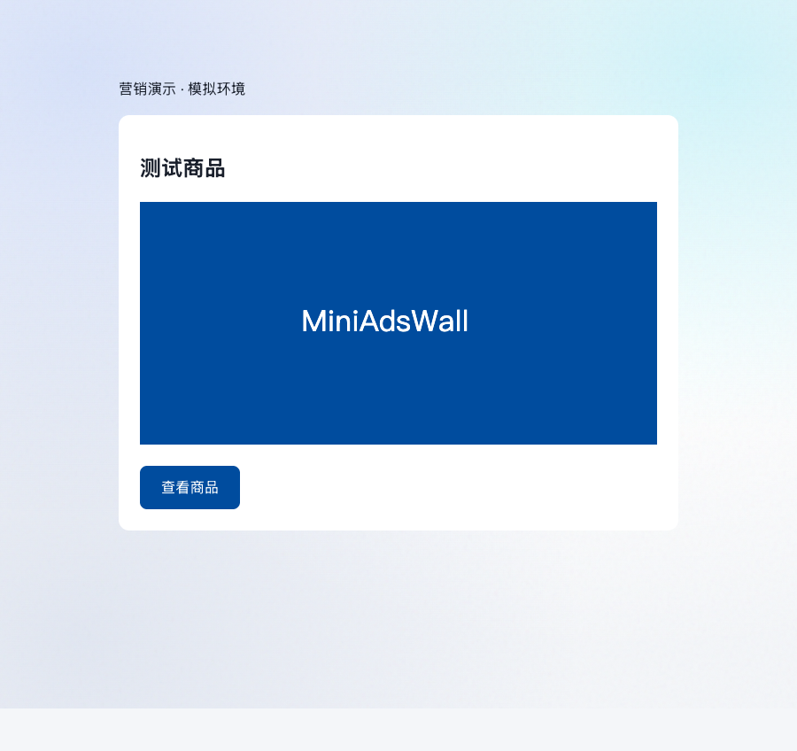

# CP00–CP03 实施与验收

日期：2026-10-10。范围：接入代码、本地真实 MySQL、两个独立 Koa 进程、Chrome 浏览器。订单、费用和素材均为 synthetic 测试数据；没有真实营销效果、生产部署、亿级容量验收。

## 交付

| 任务 | 实现 | 验证证据 |
| --- | --- | --- |
| CP00 | 共用 v1 Schema/27 个样例、Node/Python 运行时校验、阶段默认关闭、协议冻结、UTC 时钟 | marketing.test.cjs、test_marketing_contracts.py、营销 clock 用例 |
| CP01 | 品牌/商品/运营 membership、旧广告明确归属、草稿/人工审核、状态版本、事务幂等审计、010 迁移 | 空库、旧库、失败续跑、并发、结构/checksum 拒绝、品牌越权、旧字段不变 |
| CP02 | 保存 decision、600 秒签名机会、匿名 Cookie、素材文件入口、可见曝光、唯一 click 与登记落地链接 | 两 Koa 去重/篡改/环境/会话/过期/点击先于曝光/暂停后冻结凭证/事务回滚；真实 Chrome |
| CP03 | 范围限定来源凭据、支付/退款、待支付验证修订、费用追加更正、来源冻结/核对/失效、011 迁移、synthetic 生成器 | 并发退款不超额、源隔离、时间隔离、outbox 原子性、缺来源、错摘要、隔离费用阻止完整标记、原 marker 重放、新 revision 修复、旧 v3 升级 |

CP04 归因/聚合/重建、CP05 报表、CP06 看板和 S1 总体验收仍未完成。outbox 已保存，尚未新增营销消费 Worker；没有把原始事件接收称为最终有效指标。

## 代码位置

- [接口路由](../../../apps/mini-ad-wall/server/routes/marketing.routes.ts)。
- [签名与来源认证](../../../apps/mini-ad-wall/server/services/marketing/security.ts)、[展示/点击](../../../apps/mini-ad-wall/server/services/marketing/delivery.service.ts)、[事务接收](../../../apps/mini-ad-wall/server/services/marketing/ingestion.ts)、[UTC 连接](../../../apps/mini-ad-wall/server/services/marketing/clock.ts)。
- [支付/退款](../../../apps/mini-ad-wall/server/services/marketing/conversion.service.ts)、[账本/覆盖](../../../apps/mini-ad-wall/server/services/marketing/spend.service.ts)、[synthetic 案例](../../../apps/mini-ad-wall/server/services/marketing/synthetic.ts)。
- [消费者组件](../../../apps/mini-ad-wall/client/src/components/MarketingConsumer.tsx)、[曝光 Hook](../../../apps/mini-ad-wall/client/src/hooks/useAdImpression.ts)、[计时与重试](../../../apps/mini-ad-wall/client/src/hooks/impressionTracker.ts)。
- [010 迁移](../../../apps/mini-ad-wall/server/migrations/010_marketing_events.sql)、[011 迁移](../../../apps/mini-ad-wall/server/migrations/011_marketing_ingestion.sql)、[迁移服务](../../../apps/mini-ad-wall/server/services/marketing/migrations.ts)。

旧 003_marketing_events.sql 原样归档于 migrations/legacy。升级读取原 checksum 并保留 v3 registry，再登记 v10/v11；新库跳过归档文件。避免与共用 003_request_protocol.sql 的活跃编号混用，没有删除旧业务记录或自动制造历史效果事件。

## 浏览器验证

真实 Chrome 加载 `/?campaign=<id>`，通过 Koa 素材入口显示登记图片；可见 1 秒后发送曝光。首次请求被测试拦截器注入 503，重试载荷完全相同；重挂载无新有效曝光。点击返回签名 302，进入本地测试落地页并保留 miniads_click。未调用 legacy clicks。

独立追踪器在 Chrome 原生 IntersectionObserver 下验证：屏幕外和不足 50% 不发送；连续 600ms 后触发隐藏，恢复后必须重新连续 1 秒。隐藏状态通过测试覆盖 document.visibilityState 并派发事件，属于确定性浏览器测试，不是操作系统实际切换后台标签的人工验收。



## 回归记录

最终执行结果与日志在本目录。Node 测试使用一次性 MySQL 8.4 私有 socket，并清理测试库和 Koa 子进程；没有借用默认生产数据库。

- Node 全量：44 项通过、0 失败、0 跳过；其中 12 项营销用例（包含真实 Chrome）。详见 [node-tests.log](node-tests.log)。
- Python 全量：`python-tests.log`；95 项通过，13 项因专用 MySQL 集成环境未配置跳过，共运行 108 项。此前托管时序失败在复查及本次全量中通过。
- 后端构建通过：[server-build.log](server-build.log)。
- 前端构建通过：[client-build.log](client-build.log)。
- 格式：git diff --check 无错误。

27 个 JSON 合约样例在 Node 和 Python 均使用同一预期值，不接收客户端 source/environment/principal。原始回执为初次接收快照，后续验证与 coverage 状态必须读最新 revision。

## 重跑

```bash
export PATH=/opt/homebrew/opt/node@22/bin:$PATH
npm run build --prefix apps/mini-ad-wall/server
node --test --test-concurrency=1 apps/mini-ad-wall/server/tests/*.test.cjs
.venv/bin/python -m unittest discover -s tests -v
npm run build --prefix apps/mini-ad-wall/client
```

浏览器测试需设置 MARKETING_TEST_PLAYWRIGHT 指向已安装模块；若没有 Playwright 自带 Chromium，可用 MARKETING_TEST_CHROME 指向本机 Chrome。否则浏览器用例明确 skip，不算浏览器通过。当前机器使用桌面内置 Playwright 与 `/Applications/Google Chrome.app/Contents/MacOS/Google Chrome`，实际执行浏览器用例。

基线起点为 3285981，已有其他召回/可靠性改动保留。早期共用 SQL 分句错误和浏览器外部落地页超时不作为通过证据；最终使用当前 SQL 分句实现、本地落地页、修正后的来源标识执行。

## 启用条件

当前 `.env` 未配置 ADS_MYSQL_URL、MARKETING_SIGNING_KEY 或 MARKETING_SOURCES；五阶段开关仍默认关闭。实际启用前配置环境，显式执行 migrate:marketing up、播种最小归属，再创建/审核/启用活动。消费者入口 `/?campaign=<id>`；synthetic 事件生成器使用固定 run-id 与 occurred-at，通过独立来源凭据运行。

操作命令、字段及行为见 [营销 v1 合约](../../marketing-api-contract.md)。本次只修改实现和文档，不自动改写本机凭据或切换生产流量。
