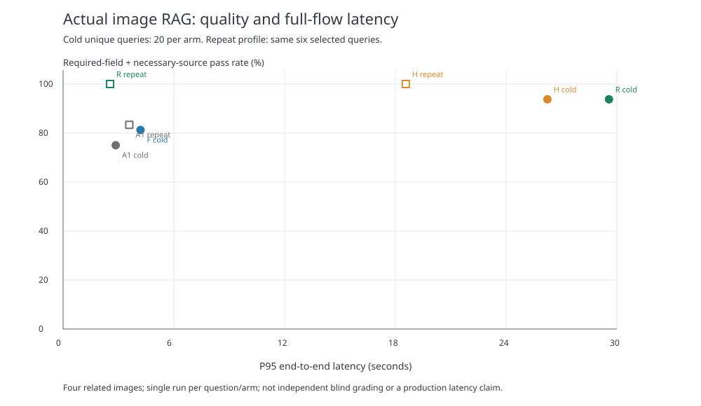

# 真实商家图片：完整多模态 RAG 效果实验

日期：2026-10-14。读取当前素材库 4 张真实 JPG，执行原图理解→检索→按需原图重读→DeepSeek 最终回答。没有写回业务数据库、生产索引或修改生产模型配置。

## 实际对照

- A1：首次 Seed 通用描述入库；标题明确引用查找＋余弦描述检索；DeepSeek 只读描述，查询 embedding 不缓存。
- F：同 A1，增加独立的查询 embedding 缓存。20 道冷查询各不相同，因此本轮冷态不能靠缓存获得收益。
- H：同 F，每题将候选原图送入 Seed 做问题相关理解，再由同一 DeepSeek 回答，包括简单题和缺事实题。
- R：同 F，使用预先固定的问题词规则，只在视觉细节/跨图比较需要时重读；售价、材质、销量、认证题不靠外观推测。对重复问题复用按图片 hash＋模型＋完整问题＋字段＋prompt 绑定的视觉证据，DeepSeek 每次仍新生成答案。

视觉模型固定为 `doubao-seed-2-0-mini-260428`，文本模型固定为 `deepseek-v4-1-flash-260910`。模型已通过实际图片请求验证，不使用模拟 vision 响应。没有偷偷换模型。

## 数据与预注册

原图：红色苹果手串掌心展示、木台两款手串、彩色水果手串掌心展示、车内苹果挂饰。素材来源是只读 ads_business_materials＋ads_business_material_images，而非此前为空的工作台私有素材理解表。每张图记录完整素材 ID、路径、文件 SHA-256；每次视觉调用前校验原文件未变。

本助手在看完原图后、生成测试答案前固定 4 道协议检查题和 20 道正式题：4 简单主体题、8 视觉细节题、4 跨图题、4 不能由图片确认的信息题。没有独立人工盲评，也没有拿 4 张相关图片伪装 120 题大实验。题目、接受词形、真假字段、路由规则和模型在 protocol/cases/manifest 中冻结；不根据答案调规则。

所有组保持相同问题、初始描述、字段 schema、业务事实边界、文本模型和候选来源。明确素材名称引用对所有组一视同仁；因此本轮不把高来源覆盖率当向量召回提升。

## 冷查询正式结果

| 组 | 可回答字段＋必要来源通过 | 来源精确的严格通过 | 缺事实题正确拒答 | Seed重读次数 | 证据就绪P95(s) | 完整流程P50(s) | 完整流程P95(s) |
|---|---:|---:|---:|---:|---:|---:|---:|
| A1 | 75.00% (12/16) | 68.75% | 100.00% (4题) | 0 | 0.32 | 1.88 | 2.85 |
| F | 81.25% (13/16) | 75.00% | 100.00% (4题) | 0 | 0.61 | 2.08 | 4.19 |
| H | 93.75% (15/16) | 87.50% | 100.00% (4题) | 20 | 24.65 | 15.60 | 26.24 |
| R | 93.75% (15/16) | 87.50% | 100.00% (4题) | 12 | 27.01 | 11.78 | 29.57 |

“字段＋必要来源通过”只要求预标注的关键字段正确、必要引用齐全，不自动证明每句话有依据。模型有时附带其他图片引用，因此额外报告要求引用集合等于目标来源的严格诊断，不能把引用 ID 合法当引用相关。失败请求计错误并保留日志。

## 重复问题工作负载

正式冷查询之后，对预先固定的 6 个问题再跑 A1/H/R；不复用最终回答，全部重新调用 DeepSeek。缓存命中只复用此前 R 的 Seed 视觉证据；这是重复问题情境，不是新问题。

| 组 | 字段＋必要来源通过 | Seed新增重读 | 视觉证据缓存命中 | 完整流程P50(s) | 完整流程P95(s) |
|---|---:|---:|---:|---:|---:|
| A1 | 83.33% (6题) | 0 | 0 | 1.98 | 3.59 |
| H | 100.00% (6题) | 6 | 0 | 15.47 | 18.56 |
| R | 100.00% (6题) | 0 | 4 | 2.10 | 2.55 |

6 次响应的 P95 对单次 API 抖动很敏感，不能称为稳定线上 P95 改善。没有后台提前理解测试问题，也没有把首次缓存填充费用隐藏成免费；冷态 Seed 收据和 warm 引用分别记录。

## 可核对的差异

| 测试题 | A1通过 | H通过 | R通过 | R重读 |
|---|---|---|---|---|
| simple-gift | True | True | True | False |
| simple-two | True | True | True | False |
| simple-rainbow | True | True | True | False |
| simple-car | True | True | True | False |
| detail-gift-surface | True | False | False | True |
| detail-gift-hole | False | True | True | True |
| detail-two-stand | True | True | True | True |
| detail-two-blue | True | True | True | True |
| detail-rainbow-leaf | False | True | True | True |
| detail-rainbow-texture | False | True | True | True |
| detail-car-ribbon | True | True | True | True |
| detail-car-tag | True | True | True | True |
| compare-surfaces | True | True | True | True |
| compare-colors | True | True | True | True |
| compare-scenes | True | True | True | True |
| compare-package | False | True | True | True |
| missing-price | True | True | True | False |
| missing-material | True | True | True | False |
| missing-sales | True | True | True | False |
| missing-certification | True | True | True | False |

## 耗时和付费请求

共 148 个真实模型请求，初始 4 张图的通用理解累计 21.34 秒；该离线建库工作由各组共同使用，未混进在线每题耗时。索引建库和 embedding 预热亦为共同准备工作，首次整体运行的墙钟需包含它们。

| 模型 | 请求 | 输入tokens（含提供方报告的图像输入） | 输出tokens |
|---|---:|---:|---:|
| deepseek-v4-1-flash-260910 | 104 | 94731 | 5468 |
| doubao-seed-2-0-mini-260428 | 44 | 163109 | 4953 |

实际金额未查询账单，因此 money=null，不能说免费。每次提交前独占写收据、保存 payload hash、请求 ID、usage 和返回状态；超时或不确定提交不自动重复请求。未记录认证头、密钥或图像 base64。

## 可得结论与限制

本轮确实跑了原图视觉模型和最终文本回答，可以评价这些图片问答的完整链路。它没有跑视频、音频、PDF，也不是视觉向量检索或完整 PageIndex/TrioRAG/CANOPY 复现。

原图重读增加可见细节，也增加冷查询延迟；按需读取避免给简单题/不可核验事实题逐个付出视觉模型成本。重复场景可用视觉证据缓存减少重复理解，但新问题不能套用该命中速度。是否“质量＋速度双提升”必须分别对 A1 与 H 比较，不能质量对 A1、速度对 H 拼成一个虚假的联合结论。

只有 4 个相关素材、每题每组一次请求，不能支持可靠总体显著性或生产 P95。视觉判断题中肯定回答型样例较多，后续应补反事实、模糊图、无目标细节与更多来源，进行独立人工盲评。source ids 合法、字段匹配与整段事实支持是不同指标。

图表：

复查：assets.json、cases.json、protocol.json、captions.json、corpus.json、trace.jsonl、receipts/、case-changes.json、summary.json。运行脚本不会替换生产素材库的 RAG；仅保存隔离实验产物。

## 字段评分与元数据绑定修复

另列只检查关键字段、不要求完整引用的诊断：{"A1": 0.8125, "F": 0.8125, "H": 0.9375, "R": 0.9375}

包装比较题的预标注必要来源要求 gift+car，但只引用 car 已能支持“哪份有包装”的正面结论；基线因此在字段正确与字段＋来源指标间存在差异。保留预注册规则，注明此题引用金标准存在需要独立审阅的歧义，不事后改 gold 抬分。

原始 H/R 的 detail-gift-surface 题读取了正确像素，但 reader 只收到 source_id，没收到素材标题映射。Seed 因不能把标题对应到 source_id 而声明不足，影响下游答案。这是实验代码缺陷，不是手掌无法识别。

修复请求，加入 source_name_map 和每张图的 material_name；新增绑定测试。原执行代码保存为 run_source_v1.py，hash 匹配原始 manifest。修复后仅该题单列验证，H/R 均正确回答手掌且引用 gift。4 个补测请求计入总请求/usage，主对照成绩保留原样，不能把补测拼入新的100%成绩。完整重跑需新建目录，不同代码版本禁止混用旧收据。

单列验证：[{"arm": "H", "pass": true}, {"arm": "R", "pass": true}]
